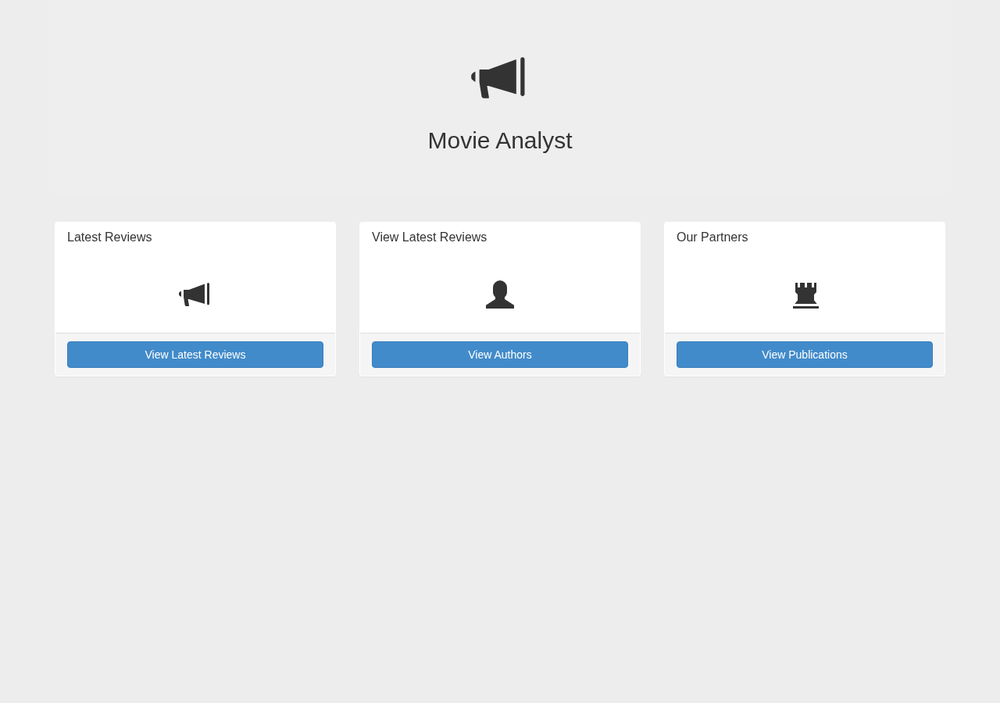
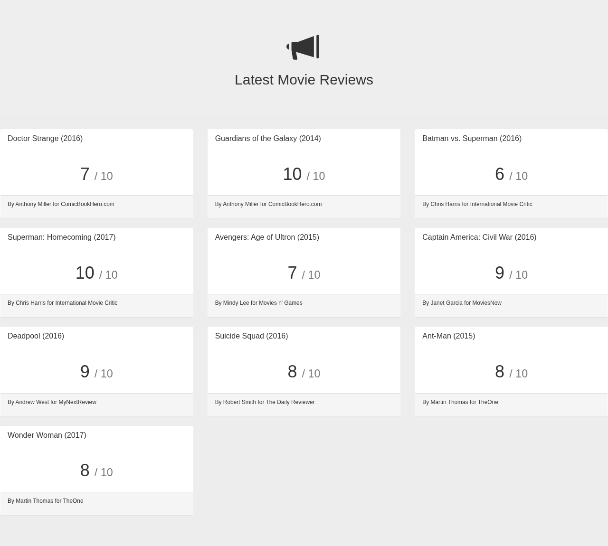
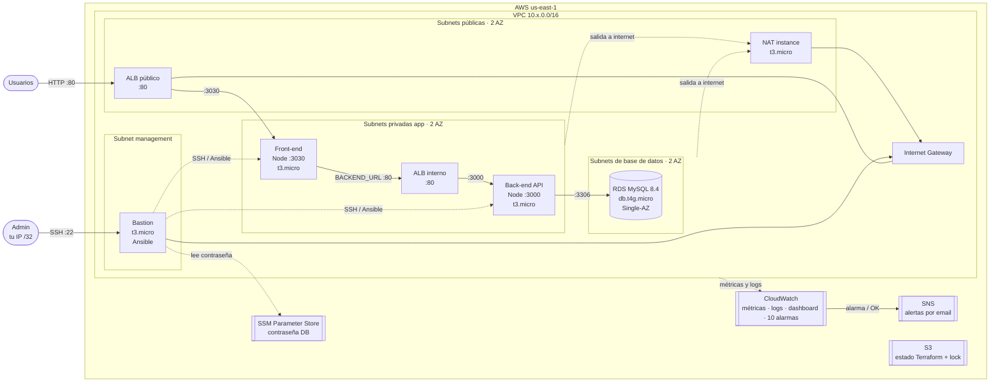
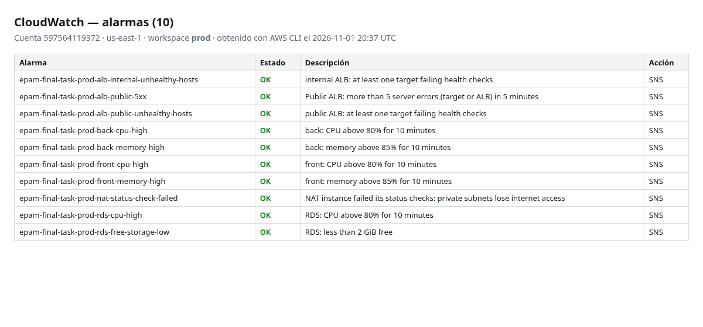
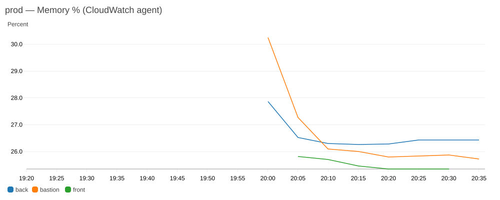
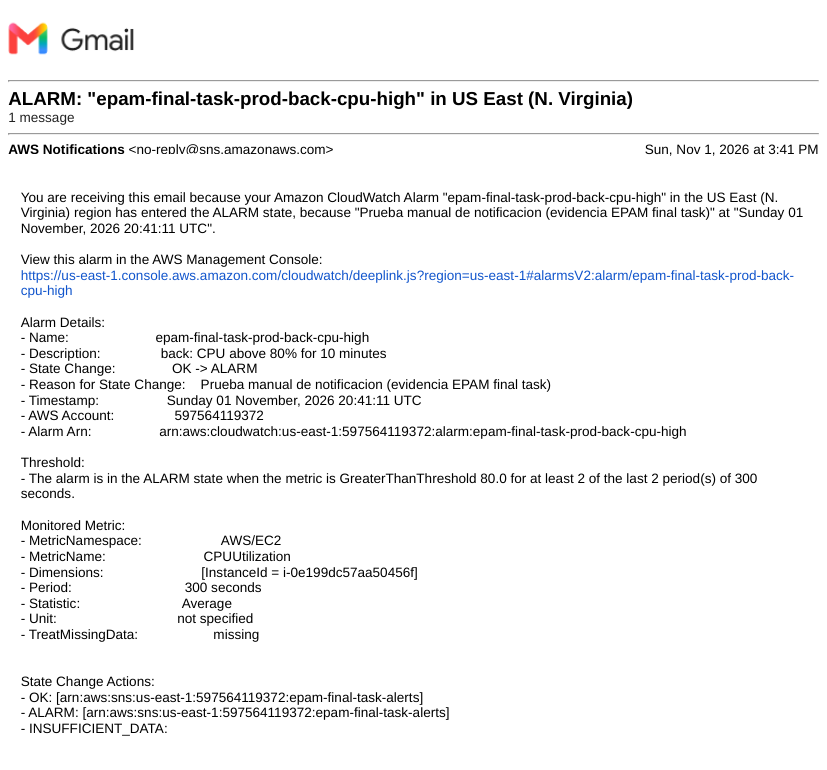

# Cloud & DevOps Final Task — Movie Analyst en AWS

Tarea final del módulo de Automation Tools. Una aplicación web de tres capas (front-end, back-end
y MySQL) migrada a AWS: **Terraform crea la infraestructura, Ansible configura los servidores desde
el bastion y CloudWatch la vigila**. Hay dos ambientes con el mismo código, `qa` y `prod`, y todo
cabe en la capa gratuita.

**Autor:** Luis Manco · EPAM DevOps LATAM

## Contenido

1. [La tarea](#la-tarea)
2. [La aplicación](#la-aplicación)
3. [La arquitectura](#la-arquitectura)
4. [Por qué infraestructura como código](#por-qué-infraestructura-como-código)
5. [Terraform: la infraestructura](#terraform-la-infraestructura)
6. [Dos ambientes: QA y Producción](#dos-ambientes-qa-y-producción)
7. [Ansible: la configuración](#ansible-la-configuración)
8. [Monitoreo](#monitoreo)
9. [Seguridad](#seguridad)
10. [Costos: cómo se mantuvo en free tier](#costos-cómo-se-mantuvo-en-free-tier)
11. [Decisiones por pilar del Well-Architected](#decisiones-por-pilar-del-well-architected)
12. [Calidad: qué comprueba cada paso](#calidad-qué-comprueba-cada-paso)
13. [Cómo desplegar](#cómo-desplegar)
14. [Cambios a la aplicación](#cambios-a-la-aplicación)
15. [Límites y mejoras](#límites-y-mejoras)

Documentos de apoyo:

- [REGISTRO-CAMBIOS.md](REGISTRO-CAMBIOS.md): cada cambio, en orden, con su porqué.
- [docs/architecture.md](docs/architecture.md): diagrama, flujo de una petición y security groups.
- [docs/evidencias/](docs/evidencias/): capturas del ambiente de producción desplegado.

## La tarea

Un cliente quiere migrar su aplicación a la nube gastando lo mínimo. Pide buenas prácticas
(AWS Well-Architected), Terraform, Ansible, monitoreo dentro del mismo proveedor y que **cada
decisión tenga una razón**. El código de la app está en
[aljoveza/devops-rampup](https://github.com/aljoveza/devops-rampup); este repositorio es un fork.

Lo que pide el cliente:

| Requisito | Cómo se resolvió |
|---|---|
| Buenas prácticas del Well-Architected Framework | Cada decisión está agrupada por pilar en [esta sección](#decisiones-por-pilar-del-well-architected) |
| Reducir costos; gastar solo con una razón de peso | Todo en free tier; NAT instance en vez de NAT Gateway; se destruye al terminar cada sesión |
| Dos ambientes, QA y Producción, con workspaces | Workspaces `qa` y `prod` con el mismo código y estados separados |
| Estado remoto para trabajar en equipo | Bucket S3 versionado y cifrado, con bloqueo nativo (`use_lockfile`) |
| Código reutilizable con módulos | 4 módulos públicos de `terraform-aws-modules` y 2 propios |
| Ansible para el bastion y las instancias | 5 roles; el bastion ejecuta todo, incluida su propia configuración |
| Monitoreo in-house | CloudWatch: agente, logs, 1 dashboard y 10 alarmas con aviso por email (SNS) |
| Diagrama de arquitectura | En [La arquitectura](#la-arquitectura), en Mermaid, versionado junto al código |

Los aspectos obligatorios:

| Aspecto obligatorio | Cómo se cumple |
|---|---|
| Nada serverless, todo sobre instancias | EC2 para front, back, bastion y NAT |
| Base de datos en el servicio adecuado | RDS MySQL 8.4 |
| DB y back-end en subnets privadas con salida a internet | Subnets privadas y de base de datos; salen por la NAT instance |
| El tráfico al back-end pasa por un load balancer | El front solo conoce la URL del **ALB interno** |
| Solo servicios del free tier | Ver [Costos](#costos-cómo-se-mantuvo-en-free-tier) |
| Un bastion ejecuta todos los procesos de Ansible | `ansible/run.sh` copia los playbooks al bastion y los ejecuta allí |

Dos cosas cambian frente al diagrama base del enunciado, y las dos tienen su razón:

- **NAT instance en vez de NAT Gateway.** El NAT Gateway cuesta unos US$32 al mes y no entra en el
  free tier. Una instancia t3.micro hace el mismo trabajo.
- **El front-end está en una subnet privada.** Solo el balanceador público queda expuesto a
  internet; la app funciona igual y hay menos superficie de ataque.

## La aplicación

**Movie Analyst** muestra reseñas de películas. Son dos apps de Node.js con Express y una base de
datos MySQL.

| Componente | Puerto | Qué hace |
|---|---|---|
| `movie-analyst-ui` (front-end) | 3030 | Renderiza las páginas con EJS; pide los datos al back-end |
| `movie-analyst-api` (back-end) | 3000 | API JSON: `/movies`, `/reviewers`, `/publications` |
| MySQL | 3306 | Tablas `movies`, `reviewers`, `publications` |



La página de películas recorre toda la cadena: front → ALB interno → back → RDS.



## La arquitectura

Cada ambiente tiene su propia VPC en `us-east-1`, repartida en 2 zonas de disponibilidad.



El recorrido de una petición:

1. El usuario abre `http://<ALB público>/movies`. El ALB la reenvía al front (puerto 3030).
2. El front llama a `http://<ALB interno>/movies`, que la reenvía al back (puerto 3000).
3. El back consulta RDS (puerto 3306) y devuelve JSON. El front lo convierte en HTML.

| Capa | Subnet | Quién puede entrar |
|---|---|---|
| ALB público | Pública | Internet, puerto 80 |
| NAT instance | Pública | Solo tráfico de la VPC (para salir a internet) |
| Bastion | Management | Una sola IP (`/32`), puerto 22 |
| Front-end | Privada | El ALB público (3030) y el bastion (22) |
| ALB interno | Privada | El front-end (80) |
| Back-end | Privada | El ALB interno (3000) y el bastion (22) |
| RDS | Base de datos | El back-end (3306) |

Cada capa solo acepta tráfico de la anterior. Las reglas apuntan al *security group* de origen y no
a direcciones IP, así que siguen valiendo aunque las IPs cambien.

## Por qué infraestructura como código

Crear esta arquitectura a mano en la consola son decenas de pantallas. Nadie recuerda después qué
se marcó en cada una, y repetirlo igual para un segundo ambiente es casi imposible.

Con Terraform y Ansible, el ambiente entero es texto en un repositorio:

| Pregunta | Sin código | En este proyecto |
|---|---|---|
| ¿Cómo se crea un ambiente nuevo? | Horas de consola, con errores | `terraform apply` + `ansible/run.sh`, unos 15 minutos |
| ¿QA es igual a producción? | Nadie lo sabe con certeza | Es el mismo código en otro workspace |
| ¿Qué cambió y por qué? | Depende de la memoria de alguien | `git log` y [REGISTRO-CAMBIOS.md](REGISTRO-CAMBIOS.md) |
| ¿Cuánto cuesta dejarlo sin uso? | Lo que tarde alguien en acordarse | Nada: `terraform destroy` borra los 86 recursos |

La idea central: **cada herramienta hace una sola cosa**. Terraform decide *qué existe* (red,
servidores, base de datos, alarmas). Ansible decide *qué hay dentro* de cada servidor (paquetes,
apps, servicios). CloudWatch dice *cómo está* todo eso.

## Terraform: la infraestructura

**Objetivo:** que toda la infraestructura salga de código reutilizable, y que un equipo pueda
trabajar sobre ella sin pisarse.

Un `apply` crea 86 recursos por ambiente. El código está en [`terraform/`](terraform/).

| Archivo | Qué crea | Módulo |
|---|---|---|
| `main.tf` | VPC, subnets, tablas de rutas, subnet de management | público `vpc` + propio `nat-instance` |
| `security.tf` | Los security groups encadenados | — |
| `alb.tf` | ALB público y ALB interno | público `alb` |
| `compute.tf` | Bastion, front y back, con sus roles IAM | público `ec2-instance` |
| `database.tf` | RDS MySQL y su contraseña en SSM | público `rds` |
| `monitoring.tf` | Log groups, alarmas y dashboard | propio `monitoring` |
| `ansible.tf` | El inventario de Ansible | — |

**Módulos.** Para lo estándar se usan los módulos públicos de
[terraform-aws-modules](https://github.com/terraform-aws-modules): están mantenidos y probados por
mucha gente, y escribir una VPC o un ALB a mano es más código y más riesgo. Los dos módulos propios
cubren lo que no tenía un módulo público que encajara: la NAT instance y el monitoreo.

**Estado remoto.** El estado vive en un bucket S3 versionado, cifrado y sin acceso público. Con
`use_lockfile`, S3 bloquea el estado mientras alguien aplica, así que dos personas no pueden
modificarlo a la vez. Ya no hace falta una tabla de DynamoDB para eso (Terraform 1.10 o mayor). El
bucket se creó a mano, como permite el enunciado.

**La contraseña de la base de datos no queda en el estado.** Terraform la genera como valor
*efímero* y la envía con argumentos *write-only* a RDS y a SSM Parameter Store. Ninguno de los dos
se guarda en el estado (requiere Terraform 1.11 o mayor).

**Recursos globales aparte.** El tópico SNS y la suscripción por email están en
[`terraform/global/`](terraform/global/), con su propio estado. Si vivieran dentro de un ambiente,
cada `destroy` borraría la suscripción y habría que confirmar el email otra vez.

## Dos ambientes: QA y Producción

**Objetivo:** probar en un ambiente idéntico al de producción, sin duplicar código.

Cada ambiente es un *workspace* de Terraform. El código es el mismo; cambia el estado, que S3
guarda por separado (`env:/qa/...` y `env:/prod/...`).

Lo que distingue a un ambiente del otro está en un solo mapa, en
[`terraform/locals.tf`](terraform/locals.tf):

| Ajuste | `qa` | `prod` |
|---|---|---|
| Rango de la VPC | `10.0.0.0/16` | `10.1.0.0/16` |
| Retención de logs | 7 días | 30 días |
| Tipo de instancia | `t3.micro` | `t3.micro` |
| Clase de RDS | `db.t4g.micro` | `db.t4g.micro` |
| Días de backup | 1 | 1 |
| Protección de borrado | no | no |

Los cuatro últimos son iguales a propósito: el free tier limita los tamaños y los backups, y
producción tiene que poder destruirse después de la demo. Están en el mapa para que subirlos en un
`prod` real sea cambiar un valor, sin tocar el resto del código.

Dos seguros contra errores:

- El workspace `default` **falla a propósito**: no tiene entrada en el mapa, así que nadie crea
  infraestructura suelta por olvidarse de elegir ambiente.
- `ansible/run.sh qa` comprueba que el workspace seleccionado sea `qa` antes de tocar nada.

Así se trabajó: cada fase se desplegó y se probó primero en `qa`. `prod` se levantó solo al final,
con el mismo código, para tomar las [evidencias](docs/evidencias/).

## Ansible: la configuración

**Objetivo:** que los servidores queden configurados sin entrar a mano a ninguno, y que repetir el
proceso no rompa nada.

El enunciado pide que **el bastion ejecute todo Ansible**. Así funciona
[`ansible/run.sh`](ansible/run.sh):

1. Espera a que el bastion termine de arrancar (su `user_data` instala Ansible).
2. Copia los playbooks y el código de las apps al bastion con `rsync`.
3. Ejecuta `ansible-playbook` **en el bastion**, con el agente SSH reenviado (`ssh -A`). La llave
   privada nunca se copia al bastion.

El playbook [`site.yml`](ansible/site.yml) tiene tres partes:

| Play | Dónde corre | Qué hace |
|---|---|---|
| 1 | El propio bastion | Parches de seguridad y agente de CloudWatch |
| 2 | Back-end | Node 22, la API como servicio, esquema y datos iniciales, agente |
| 3 | Front-end | Node 22, la UI como servicio, agente |

Los roles:

| Rol | Qué hace |
|---|---|
| `common` | Aplica las actualizaciones de seguridad y reinicia si alguna lo necesita |
| `nodejs` | Instala Node.js 22 LTS (el Node por defecto de Amazon Linux 2023 es el 18, sin soporte) |
| `node_app` | Copia el código, instala dependencias y crea el servicio systemd. **El mismo rol sirve para front y back** |
| `db_init` | Crea las tablas y carga los datos solo si la tabla está vacía |
| `cloudwatch_agent` | Publica memoria, disco y los logs de la app |

Tres detalles que importan:

- **El inventario lo genera Terraform** con las IPs y direcciones reales, así que nunca queda
  desactualizado. No contiene secretos.
- **La contraseña de la base de datos** la lee Ansible desde SSM en el bastion, con su rol IAM y
  `no_log`. No aparece en el repo, en el inventario ni en los logs. Las tareas de base de datos
  la toman del archivo de entorno del servidor, no de variables de Ansible, para que `sudo` no
  la anote en el registro del sistema.
- **Es idempotente.** La segunda ejecución termina con `changed=0`.
- **Si la contraseña no coincide, lo dice.** Antes de tocar la base de datos, Ansible comprueba el
  acceso y, si falla, explica la causa y cómo recuperarse (subir `db_password_version` y aplicar).

Al final, Ansible hace una **prueba de humo**: comprueba que la API responde y que el front muestra
películas pasando por el ALB interno y RDS. Si la app no funciona, el despliegue falla; no termina
en verde por el simple hecho de haber copiado archivos.

## Monitoreo

**Objetivo:** saber cómo están los recursos y enterarse por correo cuando algo falla, sin
herramientas de terceros.

Todo es CloudWatch, creado por el módulo propio
[`modules/monitoring`](terraform/modules/monitoring/):

- **Agente de CloudWatch** en bastion, front y back. EC2 no reporta memoria ni uso de disco por sí
  solo; el agente los publica cada 60 segundos y envía los logs de las apps.
- **Un dashboard** por ambiente con el estado de las alarmas, CPU, memoria, disco, peticiones,
  errores, targets sanos, latencia, RDS y los últimos logs.
- **10 alarmas** que avisan por email al dispararse y al recuperarse.

| Alarma | Qué detecta |
|---|---|
| CPU alta en front y back (2) | Un servidor saturado |
| Memoria alta en front y back (2) | Falta de memoria, o un agente que dejó de enviar datos |
| Status check de la NAT | La NAT caída: los servidores privados pierden la salida a internet |
| Hosts no sanos en ALB público e interno (2) | La app no responde a los health checks |
| Errores 5xx en el ALB público | Los usuarios están recibiendo errores |
| CPU alta en RDS | La base de datos saturada |
| Poco almacenamiento libre en RDS | El disco de la base de datos se está llenando |





Para probar las notificaciones se forzó una alarma a estado ALARM. Llegó el correo, y 19 segundos
después el de recuperación, cuando CloudWatch volvió a evaluar el dato real.



Algo esperado: **en un despliegue nuevo llegan correos de ALARM que se resuelven solos.** La
infraestructura existe unos minutos antes de que Ansible instale la app y el agente, y las alarmas
de hosts no sanos y de memoria lo detectan. Preferí dejarlas así antes que silenciarlas: avisan
justo de lo que deben avisar.

## Seguridad

| Medida | Detalle |
|---|---|
| Red por capas | Solo el ALB público y el bastion reciben tráfico de internet |
| SSH restringido | Al bastion solo desde una IP `/32`; a front y back solo desde el bastion |
| Contraseña de la DB | Fuera del estado de Terraform, del repo y de los logs; cifrada en SSM |
| Llave SSH | Importada como key pair; la privada no sale del equipo del administrador |
| IAM mínimo | Front y back solo publican métricas y logs; el bastion además puede leer (solo `GetParameter`) los parámetros de su ambiente |
| IMDSv2 obligatorio | En todas las instancias |
| Cifrado | Discos EBS, RDS, parámetro SSM y bucket del estado |
| Parches | El rol `common` aplica las actualizaciones de seguridad y reinicia front y back si alguna lo necesita (kernel, glibc); en el bastion solo avisa, porque Ansible corre en él |
| Dependencias | `npm audit` sin vulnerabilidades en las dos apps |

Antes de entregar se revisó el repositorio con detect-secrets, checkov, ansible-lint, shellcheck y
`npm audit`. No hay secretos en los archivos ni en el historial de git. Los hallazgos corregidos
están en [REGISTRO-CAMBIOS.md](REGISTRO-CAMBIOS.md); los que se aceptaron a propósito, cada uno con
su razón, en [.checkov.yaml](.checkov.yaml) o junto al recurso concreto. Cualquier aviso nuevo hace
fallar el CI.

## Costos: cómo se mantuvo en free tier

La cuenta usa el **plan Free de AWS con créditos**: no hay cargos a la tarjeta, pero cada hora de
recursos descuenta créditos. Por eso la regla fue **destruir al terminar cada sesión**.

| Recurso (por ambiente) | US$ por hora aprox. |
|---|---|
| 4 × EC2 t3.micro (front, back, bastion, NAT) | 0.042 |
| 2 × ALB | 0.045 |
| RDS db.t4g.micro | 0.016 |
| 4 direcciones IPv4 públicas | 0.020 |
| **Total** | **≈ 0.12** (unos US$3 al día si se deja encendido) |

Las decisiones que evitan gasto:

| En vez de | Se usó | Ahorro |
|---|---|---|
| NAT Gateway | NAT instance t3.micro | ~US$32 al mes más tráfico |
| Secrets Manager | SSM Parameter Store | US$0.40 por secreto al mes |
| RDS Multi-AZ | RDS Single-AZ | La mitad del costo de la base de datos |
| DynamoDB para el bloqueo | Bloqueo nativo de S3 | Un recurso menos |
| Herramienta de monitoreo externa | CloudWatch dentro de sus límites gratuitos | Sin licencias |

Además: un **AWS Budget** de US$10 al mes avisa por correo si algo se queda encendido, todos los
recursos llevan etiquetas (`Project`, `Environment`, `Owner`, `ManagedBy`) para filtrar el gasto, y
`qa` y `prod` no se levantan a la vez.

## Decisiones por pilar del Well-Architected

| Pilar | Decisiones |
|---|---|
| **Excelencia operacional** | Todo como código. Inventario generado por Terraform. Ansible idempotente y con prueba de humo. Despliegues reproducibles (`package-lock.json`, versión fija de Ansible). CI en cada push. Registro de cambios con el porqué |
| **Seguridad** | Red por capas y security groups encadenados. Contraseña fuera del estado. IAM mínimo. IMDSv2. Cifrado en reposo. Parches automáticos |
| **Fiabilidad** | 2 zonas de disponibilidad para los ALB y RDS. Health checks. systemd reinicia las apps si se caen. Backups de RDS y estado versionado. Alarma sobre la NAT, que es el punto único de falla |
| **Eficiencia de rendimiento** | Instancias *burstable* adecuadas a una app ligera. Node 22 LTS. El ALB interno permite añadir más back-ends sin tocar el front |
| **Optimización de costos** | Ver [Costos](#costos-cómo-se-mantuvo-en-free-tier) |
| **Sostenibilidad** | Recursos mínimos, de generación actual y apagados cuando no se usan |

## Calidad: qué comprueba cada paso

Mi enfoque viene de QA, así que pensé el despliegue como una serie de **puertas de calidad**: cada
paso comprueba algo distinto, y no se avanza si el anterior falla.

| Puerta | Qué detecta | Qué pasa si falla |
|---|---|---|
| CI en GitHub Actions | Terraform mal formateado o inválido en `qa` o en `prod`, un aviso de seguridad nuevo de checkov, problemas en Ansible o en el script, dependencias vulnerables, tests de la API rotos, un front que se cae sin el back, datos iniciales que no cargan en MySQL | El commit queda marcado en rojo |
| Validación de `admin_cidr` | Abrir el SSH del bastion a un rango en vez de a una sola IP | `terraform plan` no continúa |
| Workspace `default` | Aplicar sin haber elegido ambiente | `terraform plan` falla |
| Bloqueo del estado | Dos personas aplicando a la vez | La segunda no arranca |
| Comprobación de `run.sh` | Configurar `prod` con el workspace en `qa` | El script se detiene |
| Health checks de los ALB | Una app que no responde | El ALB deja de enviarle tráfico y salta la alarma |
| Prueba de humo de Ansible | Un despliegue que copió archivos pero no funciona | Ansible termina en rojo |
| Segunda ejecución de Ansible | Tareas que cambian algo cada vez | Se ve un `changed` distinto de 0 |
| Alarmas de CloudWatch | Problemas después del despliegue | Llega un correo |

Dos ideas que me llevo:

- **Un `apply` en verde solo prueba que los recursos existen.** Que la app funcione es otra
  pregunta; por eso la prueba de humo busca las películas en la página y no solo un código 200.
- **Lo que no se prueba en real, no se da por hecho.** Cada fase se desplegó y se comprobó en `qa`
  antes de seguir: que el back sale a internet por la NAT, que el front *no* llega a RDS, que la
  contraseña no aparece en el estado.

## Cómo desplegar

### Una sola vez

1. Usuario IAM con permisos de administrador y `aws configure` (región `us-east-1`).
2. Bucket S3 para el estado (versionado, cifrado y sin acceso público). Su nombre va en
   `terraform/backend.tf` y en `terraform/global/main.tf`.
3. Importar tu llave pública como key pair:

   ```bash
   aws ec2 import-key-pair --key-name epam-final-task --public-key-material fileb://~/.ssh/id_ed25519.pub
   ```

4. Alertas por correo. Copia `terraform/global/terraform.tfvars.example` a `terraform.tfvars`, pon
   tu email y aplica. Después **confirma el correo de AWS Notifications**.

   ```bash
   terraform -chdir=terraform/global init && terraform -chdir=terraform/global apply
   ```

5. Copia `terraform/terraform.tfvars.example` a `terraform.tfvars` y pon tu IP pública con `/32`
   (`curl -s https://checkip.amazonaws.com`).

### Cada ambiente

```bash
cd terraform
terraform init
terraform workspace select qa          # o prod
terraform apply                        # ~10 minutos
cd ..
ssh-add ~/.ssh/id_ed25519              # el agente se reenvía al bastion
ansible/run.sh qa                      # ~5 minutos; Ansible corre en el bastion
terraform -chdir=terraform output app_url
```

### Apagar

```bash
terraform -chdir=terraform workspace select qa && terraform -chdir=terraform destroy
```

### Probar una alarma

```bash
aws cloudwatch set-alarm-state --alarm-name epam-final-task-qa-back-cpu-high --state-value ALARM --state-reason "prueba"
```

## Cambios a la aplicación

El objetivo era migrar la app, no reescribirla. Solo se tocó lo necesario:

| Cambio | Por qué |
|---|---|
| `mysql` → `mysql2` en la API | El paquete viejo no soporta el método de autenticación por defecto de MySQL 8.4. Solo cambia el `require` |
| `schema.sql` nuevo | El repositorio no traía script de base de datos, solo una imagen del esquema |
| `res.staus` → `res.status` en la API | El error de escritura tumbaba el proceso entero ante cualquier fallo de la base de datos. Ahora responde 500 y sigue vivo |
| Dos dependencias quitadas de la API | No se usaban y traían 10 vulnerabilidades conocidas |
| `ejs` actualizado en el front | La versión original tenía una vulnerabilidad crítica |
| `package-lock.json` en las dos apps | Para que cada despliegue instale exactamente las mismas versiones |
| El front responde 502 si el back no contesta o devuelve un error | Antes, un fallo de conexión tumbaba el proceso entero, incluida la página de inicio |
| Ruta `/pending` eliminada de las dos apps | Nunca funcionó: el SQL estaba mal escrito en la API y el front dejaba la petición colgada. Ninguna página la usaba |
| Los datos iniciales ignoran filas duplicadas | Una carga interrumpida a medias ya no bloquea los despliegues siguientes |
| Test de la API para el fallo de base de datos | Comprueba que responde 500 y sigue viva; corre en el CI |
| El front ya no sirve su carpeta `public/` | Solo contenía las plantillas, y se podían descargar tal cual (`/views/index.ejs`). También se quitó la cabecera `X-Powered-By` |

## Límites y mejoras

Son decisiones conscientes por el límite del free tier, no olvidos:

| Hoy | Riesgo | Con presupuesto |
|---|---|---|
| Una sola NAT instance | Si se cae, los servidores privados pierden la salida a internet (la app sigue sirviendo) | Un NAT Gateway por zona |
| Un front y un back | Sin alta disponibilidad de cómputo | Auto Scaling Groups en 2 zonas detrás de los mismos ALB |
| RDS Single-AZ | Si cae la zona, cae la base de datos | Multi-AZ |
| HTTP sin TLS | Tráfico sin cifrar | Certificado de ACM, dominio y listener 443 |
| La app usa el usuario maestro de la DB | Más permisos de los necesarios | Un usuario con permisos solo sobre `movie_db` |
| SSH al bastion | Un puerto abierto, aunque solo a una IP | SSM Session Manager, sin puertos |
| El despliegue se lanza a mano | Depende de quien lo ejecuta | Un pipeline que haga `plan` en cada cambio y `apply` con aprobación |
| La NAT no recibe parches | Ansible no la configura | Actualizaciones automáticas en su arranque |

## Créditos

Aplicación original: [aljoveza/devops-rampup](https://github.com/aljoveza/devops-rampup). Su README
se conserva en [docs/README-rampup-original.md](docs/README-rampup-original.md).
