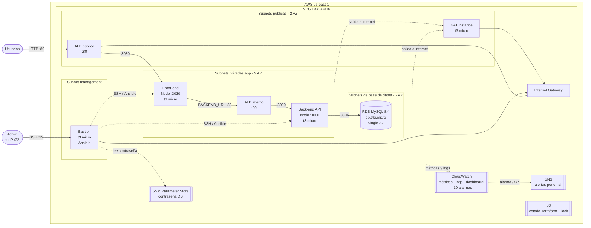

# Diagrama de arquitectura

Un ambiente (workspace `qa` = `10.0.0.0/16`, `prod` = `10.1.0.0/16`). Región `us-east-1`, 2 zonas de disponibilidad.

## Flujo de una petición

1. El usuario abre `http://<ALB público>/` → el ALB reenvía a `front:3030`.
2. El front llama a `http://<ALB interno>/movies` (`BACKEND_URL`) → el ALB interno reenvía a `back:3000`.
3. El back consulta RDS por `:3306` y devuelve JSON; el front lo renderiza.

## Security groups (mínimo privilegio)

| SG | Entrada permitida |
|---|---|
| ALB público | `:80` desde internet |
| front | `:3030` desde ALB público · `:22` desde bastion |
| ALB interno | `:80` desde SG del front |
| back | `:3000` desde ALB interno · `:22` desde bastion |
| RDS | `:3306` desde SG del back |
| bastion | `:22` desde tu IP `/32` |
| NAT | todo desde el CIDR de la VPC |
